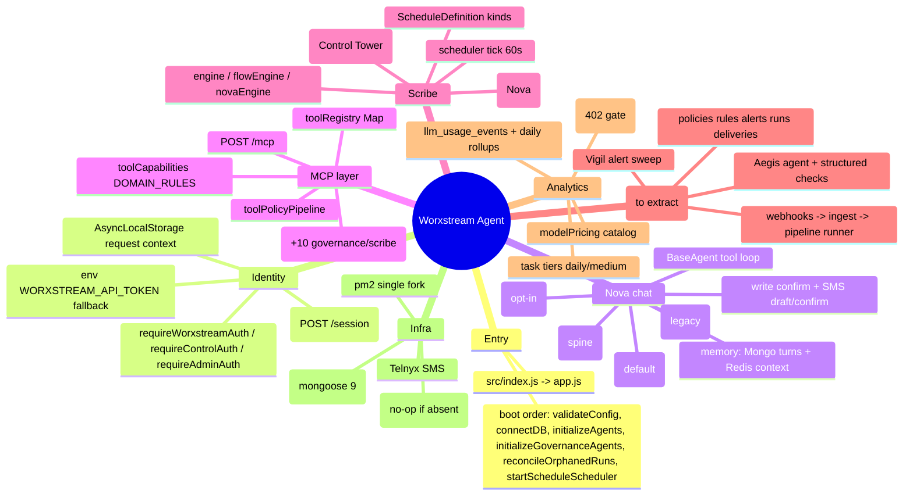

# mindmap.md — Worxstream Agent backend (`Worxstream AI infra/agent`)

> Purpose: a working map of this codebase so any change can start from "where does this live, what depends on it, what else must change".
> Read this BEFORE editing. Re-verify any file/function named here with a quick grep before relying on it (code moves).
> Last built: 2026-11-06 from a full read of the core paths. See "Coverage" at the bottom for what was read in full vs sampled.

---

> **Product intent (user, 2026-11-06):** write actions are *intentionally disabled for now* — the AI only suggests courses of action; write tools get enabled later. NOTE: in this repo write tools (`create_*`, `update_*`, `send_email`, `send_sms`, `scribe_*`) are still registered and `COWORKER_CONFIRM_WRITES` defaults to off, so nothing in this code enforces read-only. Verify where it is enforced (Laravel permissions? prompt?) before assuming.

## 0. One-paragraph summary

Express + MongoDB (+ optional Redis) service, plain JS (ESM, no build step, Node >= 18). It is the AI backend for the Worxstream ERP/CRM platform. **Nova** (chat coworker) is one Claude agent with ~290 tools (MCP-style tool registry) that call the Worxstream Laravel API. **Scribe** is the scheduler: users ask Nova to create recurring tasks; a 60 s in-process ticker re-runs Nova headlessly and delivers by email/SMS. **Governance / Control Tower** (Aegis + Vigil, policies, rules, webhook pipeline, alerts) is a *separate product prototype* bolted into this repo; it is meant to be extracted. **Analytics** meters every Claude call (USD cost, per-company wallet, per-tier model choice).

```
 Frontends (apps/agent-web, apps/chat, apps/control-tower, ...)        Worxstream Laravel API
        │  SSE / JSON                                                          ▲
        ▼                                                                      │ callWorxstreamAPI (axios, Bearer = tenant token)
 ┌─────────────────────────── agent (this repo) ───────────────────────────────┴──┐
 │ Express routes ──► runCoworkerTurn ──► BaseAgent tool loop ──► executeMcpTool ──► tools
 │      │                 (Mongo+Redis memory)      │ Claude (Anthropic SDK, usage metered)
 │      ├─► /mcp  (stateless Streamable HTTP MCP server for external clients, e.g. Telnyx SMS agent)
 │      ├─► Scribe scheduler (60 s tick) ─► runCoworkerTurn(freshConversation) ─► send_email/send_sms
 │      └─► Governance webhooks ─► Aegis pipeline ─► alerts (Vigil sweeps)
 └─────────────────────────────────────────────────────────────────────────────────┘
```

Lives in `Office projects/Worxstream AI infra/` next to `mail-agent-backend` (both are AI services; each is its own git repo). The web app and the other apps are in the separate `worxstream-platform` repo, whose apps are: `apps/{agent-web,chat,control-tower,sign,web}`, `agent-analytics`, `voice-agent`, `packages`, `tooling`, `docs`. `control_tower/` inside this repo is only a README stub ("moved to apps/control-tower").

---

## 1. Mind map (diagram)



---

## 2. Boot & runtime

- `src/index.js` → `startServer()` in `src/app.js`.
- `app.js` top-level: imports `./mcp/tools/index.js` (side effect: `registerAllTools()` fills `toolRegistry`), `validateConfig()`, builds Express app.
- Middleware order: `cors` → `express.json` (keeps `req.rawBody` only for paths starting `/api/webhooks`) → `requestContextMiddleware` (ALS) → `express.static(../public)` → `routes` → `notFoundHandler` → `errorHandler`.
- `startServer()`: `connectDB()` (Mongoose; then `ensureGovernanceSeedKeyIndexes` + `ensureAnalyticsIndexes`) → `initializeAgents()` (30 `BaseAgent` singletons) → `initializeGovernanceAgents()` (Aegis only; Vigil is housekeeping) → `reconcileOrphanedRuns()` (marks `running` pipeline runs as error after restart) → `startScheduleScheduler()` → `app.listen(PORT, 0.0.0.0)`.
- Process model: **single process, in-memory state** (session singleton, Rex tracker, identity cache, SMS/confirm memory fallbacks, catalog cache, schedule tick lock). `ecosystem.config.cjs`: pm2 `mcp-backend`, fork mode, 1 instance, `max_memory_restart 500M`, cwd `/opt/worxstream-agent`.
- Scripts: `npm start|dev|test|seed:governance`. No build.

---

## 3. HTTP surface and auth (as the code actually is)

Mounted in `src/routes/index.js`:

| Path | File | Auth middleware | Notes |
|---|---|---|---|
| `GET /health` | routes/health.js | none | model names + tool count |
| `/session`, `/api/auth/session` (same router) | nova/routes/session.js | **none** | GET status, POST set `{userId,companyId,apiToken}`, DELETE clear → sets the process-wide singleton |
| `/api/tools` (`/`, `/names`, `/debug/index`) | routes/tools.js | **none** | tool list + domain index |
| `/api/agents/*` | nova/routes/agents.js | `requireWorxstreamAuth` (except `GET /`) | see below |
| `/api/rex/*` | nova/routes/rex.js | **none** | `dashboard`, `logs`, `stream` (SSE of live agent activity) |
| `/api/price-comparison/upload-and-compare` | routes/priceComparison.js | **none** | multer upload (50 MB) of 2 xlsx → `compareStocks` |
| `/api/webhooks/worxstream` | governance/routes/webhooks.js | shared secret/HMAC **only if `WORXSTREAM_WEBHOOK_SECRET` set** | otherwise open |
| `/api/control/*` | governance/routes/control.js | `requireControlAuth` (verifies token via Laravel `GET /api/user-info`, binds company/user) | Control Tower API + schedule router |
| `/api/admin/analytics/*` | analytics/routes/admin.js | `requireAdminAuth` (`ADMIN_API_KEY`, timing-safe) | usage + wallet |
| `POST /mcp` | routes/mcp.js | **none** (tenant from headers or env/session fallback) | stateless Streamable HTTP; GET/DELETE → 405 |
| `GET /rex` | routes/index.js | none | redirects to `/` |
| `GET /` | routes/index.js | none | endpoint contract JSON |

`/api/agents` routes (all after `requireWorxstreamAuth`): `GET /` (agents list), `GET|PATCH /preferences`, `GET /models`, `GET /conversations`, `GET|DELETE /conversations/:id`, `GET /conversations/:id/turns`, `POST /confirm`, `POST /stream` (SSE primary), `POST /route` (JSON), `POST /multi`, `GET /schedules`, `GET /schedules/:id`, `GET /schedules/:id/runs/:runId`, `POST /schedules/:id/{pause|resume|run}`, `DELETE /schedules/:id`, `POST /:agentKey` (direct specialist). LLM-spending routes call `assertNovaCredits(companyId)` first (HTTP 402 `NOVA_CREDIT_EXHAUSTED`).

CORS (app.js): production = allow-list from `CORS_ORIGINS`; non-production reflects any origin with `credentials: true`.

Error handling: `errorHandler` logs + `{success:false,error}`; `notFoundHandler` 404.

---

## 4. Identity & tenancy model (critical — touch with care)

Pieces:
1. **ALS context** — `src/request/requestContext.js`: `{companyId,userId,apiToken,freshData,taskModels}`. `enterRequestContext` (middleware), `runWithRequestContext` (jobs/MCP/schedules), `setRequestContext` (merge). `requestContextFromReq(req)` reads body (`companyId|company_id|userId|user_id|apiToken|api_token`), query, headers (`x-company-id`, `x-user-id`, `x-worxstream-token` or `Authorization: Bearer`).
2. **`requestContextMiddleware`** (`src/middleware/requestContext.js`) — applies only to `/api/agents`, `/api/price-comparison`, `/api/tools`, `/api/webhooks`, `/api/control`; env-token fallback only for `/api/tools` and `/api/webhooks`. **`/mcp` is not in this list** (it builds its own ALS in the route).
3. **`buildWorxstreamContext`** (`src/utils/worxstreamCredentials.js`) resolves each field in order: ALS → request → **global session singleton** (`src/session/worxstreamSession.js`) → optional env `WORXSTREAM_API_TOKEN` (token only; company/user never default).
4. **`config.worxstream.apiToken`** is a *getter* that resolves from the above at call time; `httpClient` interceptor adds `Authorization: Bearer ${token}` per call. Tools read `{companyId,userId}` via `getWorxstreamContext()` and also put them in request bodies (`company_id`/`companyId`).
5. **Auth middlewares**
   - `requireWorxstreamAuth`: only checks that company, user and token are all *present* (from request/session/env). It does **not** verify the token or that the token owns that company/user.
   - `requireControlAuth`: verifies token against Laravel `/api/user-info` (60 s positive / 5 s negative in-memory cache in `worxstreamIdentity.js`) and `bindCompanyId`/`bindUserId` — strong binding.
   - `requireAdminAuth`: platform `ADMIN_API_KEY`.
6. **Background jobs** (schedules, governance pipeline) run with `runWithRequestContext({companyId,userId,apiToken: options.apiToken || WORXSTREAM_API_TOKEN, freshData:true})` — i.e. the **env service token**, not the creating user's token.

Consequences to remember when changing anything auth-related: see §14 (known risks).

---

## 5. Nova — chat coworker (`src/nova/`)

### 5.1 Entry points → one spine
All go through `runCoworkerTurn` (`nova/agents/coworkerPipeline.js`, ~800-line function; lines ~379-1168):
- `POST /api/agents/stream` (SSE; `streamFormatter:true, formatOutput:false`), `/route`, `/multi`, `/:agentKey`, `runConfirmAction` via `/confirm`, and **Scribe** (`novaEngine.runNovaScheduleTurn`).
- Rule from LESSONS: never call agents directly from routes — history/context/format would diverge.

### 5.2 Turn lifecycle (orchestrator mode — default; `COWORKER_MODE=specialists` or `options.agentKeys` selects legacy)
1. `loadTaskModels(company,user)` → ALS `taskModels` (daily/medium tier → model ids).
2. SSE `conversation_id`, `status`.
3. Parallel pre-work: Mongo `loadConversationState` (turns preferred over `Conversation.messages`), Redis `applyClarificationPick` → `applyClientEntityRefs` → `getContext`, `UserPreferences`.
4. Context prompt = date/time + `[Conversation summary]` + `[User preferences]` + `[Referenced records]` + `buildContextPrompt` (working set `[Session focus]`, known IDs/entities, recent results, pending SMS draft). `options.freshConversation` (Scribe) skips all history/summary/context.
5. Clarification short-circuit (`detectClarificationNeeded`: "that one / #2" with multiple recent results) → SSE `clarification`, returns `type:'clarification'`.
6. Orchestrator: `isContinueMessage` ("continue") resumes open `taskState`; otherwise `getExecutionPlan` (fast/"daily" model; returns `direct|clarify|execute` + goal/steps/risk; greeting regex skips LLM). `clarify` ends the turn with the question (`plan_clarify`) unless `autoExecutePlan` (Scribe) converts it to execute.
7. `nova.runWithEvents(...)` — the Claude tool loop (see 5.3). Results: `needsConfirmation` → `pending_confirmation`; `needsContinue` → `waiting_continue` task state.
8. Post-processing: Shopify analytics tools → deterministic XML widgets (`shopifyAnalyticsPresentation`); `get_workflow_object_tree` → `<workflow>{json}</workflow>` appended after formatting (never via LLM); optional `OutputFormatter` only if `options.formatOutput===true`.
9. `persistConversation`: rolling summary (`maybeRefreshSummary`, every `CONVERSATION_SUMMARY_EVERY_N`=10), `Conversation` upsert (UI timeline + `tool_activity`), `appendConversationTurn` (full `agent_transcript` + log). Then `updateContext` (Redis working memory) and SSE `done`.
10. Legacy specialists path: `resolveAgentKeys` (LLM router, fast model, last 6 turns) → general chat if `none` → `getNovaPlan` (multi-agent only) → `runAgentsOnce` (single/parallel/sequential) → `selfCheckCompletion` loops (`AGENTS_SELF_CHECK_MAX_LOOPS`=1) → formatter optional.

SSE event types seen: `conversation_id, status, plan, agent_selected, tool_use, tool_result, text, clarification, confirmation_required, task_progress, done, error`.

### 5.3 `BaseAgent` (`nova/agents/BaseAgent.js`)
- 30 singletons from `AGENT_DEFINITIONS` (`nova` orchestrator + 29 specialists), created in `router.initializeAgentInstances`.
- System prompt = `SOUL.md` (+ cached read) + specialist prompt (de-duplicated by `stripDuplicatedSharedRules`) + `COWORKER_SHARED_RULES` + resume/ID-resolution notes + domain playbook (`docs/playbooks/*.md`, specialists only).
- `getTools()`: orchestrator = all registry tools except domain `governance`, `invoke_agent`, `get_relevant_policies`; with tool-search (`tool_search_tool_bm25_20251119`, `defer_loading:true`) when enabled or >40 tools. Specialists = union of `index.byDomain[domain(s)]` + `lookup` bucket + `extraTools`; empty set → `[]` + loud error (never all tools).
- `runWithEvents`: loop up to `AGENT_MAX_TOOL_ITERATIONS`(15) per slice × `AGENT_CONTINUE_SLICES`(3). Handles `max_tokens` continuation, tool_use/tool_result pairing, `_oneToolAtATime` (Scribe), list input normalization, write-confirm gate, SMS "draft then confirm in a later turn" guard, recent-confirmed-write replay (fingerprint) to avoid duplicate creates. Records `rex.toolCall`.
- **Stop (cancel in-flight query)**: web Stop button/Esc aborts the `/agents/stream` fetch → `res.on('close')` aborts an `AbortController` in `routes/agents.js` → `options.abortSignal` → `runCoworkerTurn` (checked before plan / before agent run) → `context._abortSignal` → `runWithEvents` (checked each round and between tool calls; signal forwarded to `createMessage(params, meta, {signal})`). Returns `{aborted:true, rawText}`; pipeline persists a clean turn (user msg + partial text or "Stopped.", no tool transcript) with `log.status='stopped'` (own bucket in admin Quality `outcomes.stopped`). SSE writes are guarded after disconnect. Orchestrator path only; legacy specialists path ignores the signal. Test: `test/context/abort-signal.test.js`.
- `run()` (older, non-event loop) is used by `callAgent` and `GovernanceAgent`-like flows.
- Model per call: `context.model` or tier via `inferTaskTier(phase)`: phases router/nova_plan/formatter/summary/self_check/execution_plan/general_chat → `daily`; everything else (agents) → `medium`.

### 5.4 Agents (`agentDefinitions.js`) — key → domain (extraTools)
`nova`(orchestrator, domain none, tool-search), `estimate`, `invoice`, `shopify`, `creditMemo`(credit_memo), `purchaseOrder`, `bill`, `customer`, `contact`, `product`, `vendor`, `job`, `task`, `project`, `hr`, `finance`(domains finance+config), `workflow`, `company`, `address`, `config`, `systemFinder`, `priceComparison`, `salesOrder`, `inventory`, `deal`, `crm`(crm+deal, tool-search), `calls`, `payments`, `communications`(tool-search), `reports`. Status labels in `AGENT_STATUS_LABELS`. Router prompt lists all non-nova agents.

### 5.5 Memory layers
| Layer | Store | Key/Collection | Purpose |
|---|---|---|---|
| UI timeline | Mongo `conversations` | (company_id,user_id,conversation_id) unique | messages + `tool_activity`, `conversation_summary`, `summary_through_turn` |
| Turns | Mongo `conversationturns` | + turn_index unique | user text, `ui.content`, Anthropic `transcript` (tool_use/tool_result capped 4000 chars), `log` (status, plan, tools, usage) — source of agent history when present |
| Prefs | Mongo `userpreferences` | (company,user) | free-form prefs + `model_tiers` |
| Working set | Redis `ws:ctx:{c}:{u}:{conv}` TTL 1800 s | entities, entityRefs, recentResults, workingSet (sessionGoal, activeTask, taskState, executionPlan, pendingClarification, lastOutcome, toolNotes), lastAgent/lastAction/lastSearch | **No in-memory fallback** — Redis off ⇒ silently empty |
| Plan state | Redis `ws:plan:...` | attempts | self-check loop bound |
| Pending write confirm | Redis `ws:pending:...` (+`:recent`) with in-memory fallback | TTL 300 s | `COWORKER_CONFIRM_WRITES=true` gate; `/api/agents/confirm` |
| SMS drafts | Redis `ws:sms-draft:{c}:{u}:{id}`, `ws:sms-latest:{c}:{u}` + in-memory | TTL 600 s | draft → user confirm → send |

Redis client (`services/redisClient.js`): optional, all errors swallowed, 3 s command timeout; `REDIS_URL` or `REDIS_HOST/PORT/USERNAME/PASSWORD` (auto-TLS on port 25061).

Context window utilities: `utils/contextWindow.js` (sliding window + token trim, 4 chars/token estimate in `tokenCounter.js`), `conversationHistory.js` (orchestrator uses full transcript; specialists use compact text window 6/12 msgs), `conversationSummary.js`, `dateContext.js`, `validateMessages.js` (repair orphan tool pairs).

### 5.6 Other Nova files
- `OutputFormatter.js` — LLM that converts text to frontend XML tags (`<table> <stats> <details> <alert> <chart> <gauge> <trend> <workflow>`); strips code fences; continuation up to 3 passes; streaming via `streamSectionBuffer` coalescing (40 ms/96 chars). Off by default.
- `shopifyAnalyticsPresentation.js` — columns+rows → stats/chart/table XML in code ("Sidekick pattern"); `stripModelStatsAndCharts`, `mergeShopifyPresentationWithCommentary`.
- `pendingConfirm.js` — `isWriteTool` (capabilities `safety==='write'`, `create_/update_/delete_` prefixes, `send_email|send_object_email`, mutating `scribe_*`), `usesAgentChatConfirm` (`send_sms` only).
- `executionPlan.js`, `PlanState.js`, `workingMemory.js` (pure functions: delta/merge/prompt, clarification pick), `ConversationContext.js`, `conversationTurns.js`, `agentTranscript.js`, `policies/listPolicies.js` (hard cap page size, strip `all_pages`), `playbooks.js` (`DOMAIN_FILES`: estimate, invoice, customer, workflow, reports, shopify, scribe/schedules; extras `reports-charts.md`), `soul.js` (reads `SOUL.md`), `coworkerRules.js` (shared rules).
- `AgentTracker.js` ("Rex") — in-memory stats, 200-item ring buffer, SSE subscribers, JSONL log to `logs/rex.jsonl`. Used by `/api/rex/*`.
- `mcpSurface.js` — what external MCP clients see: tools except `invoke_agent`, `get_relevant_policies` and domain `governance` (so **scribe_*, send_sms, send_email and all write tools are public on `/mcp`**), plus resources `coworker://soul`, `playbook://{domain}`, `coworker://session-focus` and prompts `playbook_<domain>`.
- `nova/index.js` re-exports the public API.

---

## 6. MCP / tool layer (`src/mcp/`)

- `server.js`: `toolRegistry` Map. `registerTool(name,{title,description,inputSchema(zod shape),capabilities},callback)`. `executeMcpTool(name,input,ctx)` = `beforeToolCall` → callback → parse first `content[0].text` JSON → `afterToolCall` (wraps non-`{success}` results), errors → `onToolError`. **Logs full input JSON for every call.** `createMcpServer()` builds a fresh SDK `McpServer` with the public tools per `/mcp` request. `getAnthropicTools(filter)` / `getAnthropicToolsForToolSearch(filter)` convert zod → JSON schema once (`z.toJSONSchema`, memoized).
- `toolCapabilities.js`: `DOMAIN_RULES` — ordered, **first substring match wins**; `_report`/`goal`/`get_report` forced to `reports` first. Action/safety inferred from name prefix (`list_`, `get_`, `create_`, `update_`/`quick_update_`, `delete_`, `clone_`, `bulk_action_`, `workflow`, `compare`). Unmatched ⇒ domain `unknown` (unreachable by specialists). Explicit `capabilities` on registerTool override inference.
- `toolIndex.js`: `getToolIndex()` memoized 5 s: `{tools, byDomain, readTools, writeTools}`.
- `toolPolicyPipeline.js`: `beforeToolCall` normalizes `list_*` input (page size cap, drop `sort`/`take`/`all_pages`), `afterToolCall`, `onToolError`.
- `tools/helpers`-style rule: every tool does `getWorxstreamContext()` → `callWorxstreamAPI({method,endpoint,data})` → returns `{content:[{type:'text',text:JSON.stringify(result)}]}`. `callWorxstreamAPI` (`services/httpClient.js`) returns `{success,data}` or `{success:false,error}` (never throws). GET sends `data` as query params.
- Register new module: add to `tools/index.js` (`registerAllTools`) AND ensure a `DOMAIN_RULES` pattern matches (or pass explicit `capabilities`) AND an agent with that domain exists. Guard test: `test/context/agent-tool-domains.test.js`.

### 6.1 Tool modules (file → #tools → Worxstream API prefix)
addresses 12 (`/addresses/*`, `/addresses/exemptions/*`) · bills 3, creditMemos 3, estimates 3, invoices 3, purchaseOrders 3, salesOrders 3 (all `/master-objects/{list,show,store}` with `appName`) · calls 5 (`/livekit/voice-agent/session-report/*`) · communications 5 (`/notifications/*`, `/master-objects/email/send`, public company email, `/company/email-outbox/list`) · company 46 (`/company/*`, `/branches/*`, `/contacts-management/*`, `/custom-number-range/*`, `/payment-instructions/*`, `/signatures/*`) · config 7 (`/master/config/*`, `/framework/*`, `/helper/country-codes`) · contacts 7 (`/master/contact/*`) · crm 8 (`/modules/*` incl. `global-search`) · customers 5 (`/master/customer/*`) · deals 6 (`/transaction/deal/*`, `/modules/get-pipelines`) · finance 19 (`/master/tax/*`, `/master/config/*chart*,dropdown*,fields*`) · helpers 2 · hr 24 (`/hr/*`) · inventory 14 (`/inventory/*`, `/warehouses/*`) · jobs 3, projects 6, tasks 3 (`/transaction/*`) · lookup 1 (`resolve_entity`) · payments 5 · priceComparison 1 (`compare_stock_prices`, takes already-computed JSON) · products 15 (`/master/product/*`) · reports 23 (`/report/*`, `/motili/orders/list`, inventory report endpoints) · shopify 23 (`/shopify/*`, 3 s analytics cooldown) · sms 3 (`draft_sms`, `send_sms`, `get_sms_status`; Telnyx; STOP footer auto-appended) · subscriptions 2 (`/v1/master-subscriptions`) · systemFinder 2 · vendors 5 · workflows 8 (`/workflow/*`).
Governance-registered via `tools/index.js`: `get_relevant_policies` (`governance/tools/catalogTools.js`) and 9 `scribe_*` tools (`governance/tools/scribeTools.js`).

Special tools: `resolve_entity` (name→ID; `global_search` first for customer/contact/product/vendor/job/project/task/estimate/invoice/deal, else dropdown/list fallbacks in `ENTITY_LOOKUPS`), `global_search` (CRM module), `draft_sms/send_sms`, `send_email` (public company email code `WORXSTREAM_PUBLIC_EMAIL_CODE`), `send_object_email` (needs object_id + PDF).
Quirk: `create_invoice` etc. take LLM-supplied `sub_total/grand_total` with `sections: []` (no line-item building) — business-logic is thin and trusts the model.

---

## 7. Scribe — scheduler (`src/governance/schedules/` + `governance/tools/scribeTools.js`)

> Physically lives under `governance/` but is a Nova/Scribe feature — it stays when governance is extracted. `criteria_report` schedules are the Control Tower part.

- **Model** `ScheduleDefinition` (collection `reportdefinitions`): `kind` = `flow_recipe` (Nova-created) | `criteria_report` (Control Tower missing_fields / negative_profit scans on estimates/invoices); `source` nova|control_tower; `flow` (Mixed: recipients, channel email|sms, timezone, subject_template, message_template, engine nova|process|send_only, prompt/intent, legacy steps/periods/metrics/data_source); cadence `interval` (every N days at `run_at_hour_utc`), `monthly` (day 1-28 at local hour in tz), `hourly` (UTC window start-end); `active`, `next_run_at`, `last_run_at`, soft `deleted_at`. Max active flow schedules per user: `MAX_ACTIVE_FLOW_SCHEDULES = 25`.
- **Model** `ScheduleRun` (collection `reportruns`): status running|completed|error|partial, progress steps, delivery info, summary, rows (criteria hits), error fields.
- **Tools** (`scribe_*`, domain `scribe`): create (supports clone), list, pause, resume, delete (soft), update, run_now, list_runs, get_run — all owner-scoped by (company_id, user_id).
- **Ticker** (`scheduler.js`): every 60 s, find ≤20 due (`active`, `next_run_at <= now`), `assertNovaCredits` (if exhausted push +1 h), `executeScheduleDefinition` sequentially; on error push `next_run_at` +1 h. In-process `ticking` flag only (**no distributed lock** ⇒ unsafe with >1 instance).
- **Dispatch** (`engine.js`): `executeScheduleDefinition/queueScheduleDefinition` → `isFlowRecipe` → `flowEngine.{execute,queue}FlowRecipe` else criteria path (`engine.js` `fillScheduleRun`, uses `criteria.js`). Manual run = `setImmediate` background + 202 pending run.
- **Flow execution** (`flowEngine.fillFlowRun`): steps from `resolveFlowSteps`; Nova flows use a single `nova_run` step → `novaEngine.runNovaScheduleTurn` → `runCoworkerTurn` with conversation id `schedule:{defId}:{runId}`, `freshConversation, autoExecutePlan, scheduledDelivery, oneToolAtATime, skipClarification`; the prompt is wrapped by `buildScheduledAgentMessage` (SMS ≤1400 chars + "call send_sms once"; email = complete minimal HTML + "call send_email once"). Run fails if Nova asked for clarification/confirmation/continue or **didn't call a successful `send_email`/`send_sms`**. Legacy steps: `invoice_report` (period totals), `tool`, `compose`, `deliver` (`deliverToRecipients`: Telnyx per recipient or `send_email`). Templates: `renderScheduleTemplate` `{{date}} {{name}}`.
- **Credentials**: `withDefinitionCredentials` uses `options.apiToken || WORXSTREAM_API_TOKEN` + definition's company/user (service token, not the user's).
- **HTTP**: `/api/agents/schedules*` (Nova UI, owner-scoped) and `createScheduleRouter()` mounted in `/api/control` (`/report-definitions*`, `/report-runs*`). Duplicate logic in two places — keep both in sync or consolidate.
- Docs: `docs/playbooks/schedules.md`, Nova prompt SCHEDULES blocks in `agentDefinitions.js` and `coworkerRules.js`.

---

## 8. Governance / Control Tower (prototype — to be extracted) (`src/governance/`)

Flow: Worxstream webhook → `POST /api/webhooks/worxstream` → `verifyWebhookRequest` → `eventFromWorxstreamWebhook` (normalizes many envelope shapes; `normalizeEventType`: `estimate_created`/`estimateCreated` → `estimate.created`) → `acceptGovernanceEvent` (dedupe via `ProcessedEvent` unique (company,event_id); re-run if no run exists) + `recordInboundDelivery` → `startPipelineInBackground` (`setImmediate`, ALS with **env token**) → `runPipeline`:
1. create `PipelineRun`; `hydrateSharedContext` (payload is source of truth; fetches overdue invoices / product stock only when missing).
2. `loadPolicyCatalog(company,event)` from `catalogContext` (active policies + active rules for event; in-memory/Redis snapshot, invalidated on policy/rule CRUD).
3. `runAegisChecks`: deterministic `structuredChecks` (numeric thresholds extracted from catalog text) + Aegis LLM (`GovernanceAgent.run`, main model, read-only `get_*/list_*` tools via `extraTools`) → JSON findings; `mergeStructuredOverLlm`; one step per catalog item.
4. `GovernanceAlert` per non-pass step; status `pass|flagged|error|stopped`. Cooperative stop between steps.
- **Vigil** (`vigil/alertSweep.js`): re-evaluates open alerts vs current catalog with Aegis (`evaluateGovernanceEvent`), resolves or permanently deletes stale ones.
- **Models** (collections default-pluralized): `GovernancePolicy`, `GovernanceRule` (event_type + event_types, condition/action/priority), `GovernanceAlert`, `GovernanceChunk` (RAG index, evaluation doesn't use it), `PipelineRun`, `ProcessedEvent`, `WebhookDelivery`, `HiddenWebhookDelivery` (soft-hide of deliveries), plus the shared `ScheduleDefinition/ScheduleRun`.
- **Routes** `/api/control`: agents, pipelines, policies CRUD, rules CRUD, runs (list/get/stop/restart/delete), deliveries (list/delete/redeliver=replay into pipeline/deleted-among), alerts (list/sweep/delete/resolve/patch), dashboard, plus schedule router.
- **Seed**: `seed/seedData.js` + `npm run seed:governance` (`SEED_COMPANY_ID`, `SEED_FORCE_UPDATE`).
- Imports from the rest of the repo: `config`, `services/httpClient`, `services/telnyxClient` (schedules), `mcp/server` (executeMcpTool, registry), `request/requestContext`, `utils/worxstreamCredentials`, `analytics/usageMeta`, `llm/anthropicClient`, `nova/agents/coworkerPipeline` (only `schedules/novaEngine.js`).

### 8.1 Extraction seams (what to cut when splitting)
Stays (agent): `nova/**`, `mcp/**`, `analytics/**`, `session`, `request`, `services`, `llm`, `utils`, **Scribe**: `schedules/{scheduler,engine,flowEngine,novaEngine,routes}`(flow parts), `models/Schedule*`, `tools/scribeTools.js`.
Moves (governance project): `pipeline/*`, `agents/*`, `vigil/*`, `routes/{control,webhooks}.js`, `models/{GovernancePolicy,GovernanceRule,GovernanceAlert,GovernanceChunk,PipelineRun,ProcessedEvent,WebhookDelivery,HiddenWebhookDelivery}.js`, `seed/*`, `db/governanceIndexes.js`, `tools/catalogTools.js` (decide), `schedules/criteria.js` + criteria path of `engine.js` + `kind:'criteria_report'`, `/api/control/report-*` routes.
Seams in this repo that reference governance today:
- `app.js` (initializeGovernanceAgents, reconcileOrphanedRuns, scheduler start, `stopScheduleScheduler`)
- `db/connection.js` (`ensureGovernanceSeedKeyIndexes`)
- `routes/index.js` (webhooks + control mounts)
- `mcp/tools/index.js` (`registerGovernanceTools`, `registerScribeTools`)
- `nova/routes/agents.js` imports `ScheduleDefinition`, `ScheduleRun`, `schedules/routes` helpers, `engine`, `flowEngine`
- `mcp/toolCapabilities.js` (`relevant_policies` → `governance`), `mcp/server.js`/`nova/mcpSurface.js` (`isPublicMcpTool` excludes governance domain), `BaseAgent.getTools()` (excludes governance)
- `config/index.js` and `analytics/{taskModels,models/LlmUsageEvent}` mention governance phases
- `analytics`: `LLM_USAGE_PHASES` includes `governance`.

---

## 9. Analytics, billing, models (`src/analytics/`, `src/llm/`)

- `llm/anthropicClient.js`: single `Anthropic` client; `createMessage(params, meta)` and `streamMessage(...)` both call `recordUsageAsync` (setImmediate). Every Claude call must go through these to be metered.
- `recordUsage`: needs companyId+userId (from meta or ALS) else skips; writes `llm_usage_events` and 8 `llm_usage_daily` rollup rows (company/user × agent × model combos); increments wallet spend.
- `modelPricing.js`: `MODEL_CATALOG` (Claude 5 family: fable-5-1, opus-5-5, sonnet-5-5, haiku-5-5, mythos..., plus 4.x entries), `resolveModelRates` (family fallbacks, Haiku 5.5 >100k-token tier), `listModelCatalogForApi`. `usageNormalize.js` computes cost from usage incl. cache read/write.
- `novaWallet.js` + `CompanyNovaWallet` (`company_nova_wallets`): `limits_enabled`, free/purchased/spent USD, `model_tiers`; `assertNovaCredits` → 402; admin set allowance / grant credits. No doc = unlimited.
- `taskModels.js`: tiers `daily|medium|hard|advanced` (only daily+medium active). Precedence user prefs → company wallet tiers → defaults (`DEFAULT_TASK_MODELS`: daily = `config.anthropic.fastModel`, medium = `config.anthropic.model`, hard `claude-opus-4-6`, advanced `claude-opus-4-1`). `getModelForTier` reads ALS.
- **Quirk**: pricing catalog lists Claude 5 models but `config` defaults are `claude-sonnet-4-6` / `claude-haiku-4-5`; `TOOL_SEARCH_SUPPORTED_MODELS` is a hard-coded list of 4.x ids — a 5.x model would have tool-search auto-disabled unless `ANTHROPIC_USE_TOOL_SEARCH=true`.
- `queries.js` + `routes/admin.js`: overview/companies/company/user usage and wallet admin.

---

## 10. Configuration (`src/config/index.js`) — important env vars

Required: `ANTHROPIC_API_KEY`, `WORXSTREAM_BASE_URL`, `MONGODB_URL`. Models: `ANTHROPIC_MODEL`, `ANTHROPIC_MODEL_FAST` (dated/retired ids auto-fall-back with warning), `ANTHROPIC_USE_TOOL_SEARCH`, token caps `ANTHROPIC_MAX_TOKENS_{AGENT,FORMATTER,ROUTER,NOVA,CONVERSATION,CONVERSATION_SHORT}`, price overrides. Tenancy: `WORXSTREAM_API_TOKEN` (service token for jobs/webhooks), `ADMIN_API_KEY`, `WORXSTREAM_WEBHOOK_SECRET`, `WORXSTREAM_PUBLIC_EMAIL_CODE`. Runtime: `COWORKER_MODE` (orchestrator|specialists), `COWORKER_EXECUTION_PLAN`, `COWORKER_CONFIRM_WRITES`, `COWORKER_PENDING_CONFIRM_TTL`, `AGENT_MAX_TOOL_ITERATIONS`, `AGENT_CONTINUE_SLICES`, `AGENT_MAX_LIST_PAGE_SIZE`, `AGENTS_SELF_CHECK_MAX_LOOPS`, `CONVERSATION_SUMMARY_EVERY_N`, `COWORKER_SCRAPE_ENTITY_IDS` (legacy), `AGENT_TRANSCRIPT_MAX_RESULT_CHARS`. Context: `MAX_CONTEXT_MESSAGES/TOKENS`, `RESERVE_TOKENS`, `SPECIALIST_*`. Redis: `REDIS_*`. Server: `PORT`, `NODE_ENV`, `CORS_ORIGINS`, `BACKEND_URL|PUBLIC_URL`. SMS: `TELNYX_API_KEY`, `TELNYX_FROM_NUMBER`, `TELNYX_MESSAGING_PROFILE_ID`, `TELNYX_US_MESSAGING_PROFILE_ID`, `TELNYX_ALPHA_SENDER`, `TELNYX_SMS_DRAFT_TTL`.
~80 direct `process.env` reads exist (config + a handful in governance/runner, verifyWebhook, engine, communications, redisClient, identity). `.env.example` still lists `DEFAULT_COMPANY_ID/DEFAULT_USER_ID` though code no longer uses them.

---

## 11. Data stores

Mongo collections: `conversations`, `conversationturns`, `userpreferences`, `reportdefinitions` (ScheduleDefinition), `reportruns` (ScheduleRun), `governancepolicies`, `governancerules`, `governancealerts`, `governancechunks`, `pipelineruns`, `processedevents`, `webhookdeliveries`, `hiddenwebhookdeliveries`, `company_nova_wallets`, `llm_usage_events`, `llm_usage_daily`.
Redis key prefixes: `ws:ctx:`, `ws:plan:`, `ws:pending:`, `ws:sms-draft:`, `ws:sms-latest:` (+ governance catalog snapshot when enabled).
In-memory (lost on restart / not shared): session singleton, `rex` tracker + `logs/rex.jsonl`, identity auth cache, `memoryPending` / `memoryDrafts`, catalog snapshot, `cancelRequested`/`persistQueues` (pipeline), schedule tick flag, tool index cache, soul/playbook caches.
Disk: `uploads/` (multer, deleted after compare), `logs/rex.jsonl`.

---

## 12. Tests (`npm test` → `node --test test/**/*.test.js`)

186 tests, all passing (2026-11-10; the 4 earlier failures were fixed: `scribe` added to known domains, stale SOUL/model-tier assertions updated, `send_sms` now counted by `isWriteTool`).
Areas: `test/context/*` (domains, transcript, working memory, tenant isolation, conversation turns, execution plan, write confirm, orchestrator, Shopify presentation, MCP surface, calls filter, list-page safety), `test/control/*` (alert sweep, catalog, p0-trust, pipeline config, replay, report criteria), `test/analytics/*`, `test/db/governance-indexes`, `test/flowEngine.test.js`, `test/streamSectionBuffer.test.js`. Several tests assert on **source text** (`readFileSync` + `includes`) rather than behaviour — they break on refactors. No tests for route auth, `/mcp`, scheduler tick, `BaseAgent` loop with a fake Anthropic client.

---

## 13. Docs & prompts that shape behaviour (edit these, not code, for tone/format changes)

`SOUL.md` (identity/guardrails, prepended to every Nova/specialist prompt), `docs/playbooks/*.md` (per-domain SOPs; reports/shopify include `reports-charts.md` chart XML shapes; schedules), `src/nova/agents/coworkerRules.js` (shared rules), `agentDefinitions.js` (per-agent prompts), `OutputFormatter.js` `FORMATTER_PROMPT` (UI tag contract — must stay in sync with the frontend `parseXML.ts` in the chat app), `governance/agents/definitions.js` (Aegis/Vigil prompts + JSON output contract).
Repo docs: `README.md`, `QUICK_START.md`, `FEATURES.md`, `FRONTEND_CHANGES.md`, `LESSONS.md` (design decisions & gotchas — read before changing memory/tools/reports), `project_knowledge.md` (older deep-dive; counts are stale: says ~193 tools/22 agents; now ~288 tools/30 agents), `docs/GOVERNANCE_*`, `docs/REDIS_CONTEXT_AND_CACHE.md`, `docs/WORXSTREAM_WEBHOOKS_REQUIRED.md`, `docs/nova.md` (very old design note), Postman collection (1.2 MB), `src/scripts/analyzePostmanCollection.js` + `utils/postmanParser.js` (find API endpoints without tools).

---

## 14. Known issues & risks (verified in code unless marked)

Security / tenancy
1. Global session singleton (`worxstreamSession.js`) is a fallback for every context field; `POST/DELETE /session` unauthenticated ⇒ cross-tenant leakage for any path without request credentials (e.g. `/mcp`, webhook/job paths).
2. Unauthenticated: `/api/tools*` (incl. `/debug/index`), `/api/rex/*` (dashboard, logs, SSE of live prompts), `/api/price-comparison/*`, `/mcp`, `/session`. `/api/webhooks` open when no secret; webhook-supplied `company_id` is trusted.
3. `requireWorxstreamAuth` only checks presence of token+company+user; token ownership is not verified (unlike `requireControlAuth`).
4. Scheduled runs and governance pipeline execute with env `WORXSTREAM_API_TOKEN`, not the user's token.
5. `/mcp` exposes write tools incl. `scribe_*`, `send_email`, `send_sms` publicly (only governance domain excluded).
6. Logging: full tool inputs and API error bodies are logged; Rex writes prompts (first 200 chars) to `logs/rex.jsonl`.
7. Non-prod CORS reflects any origin with credentials.

Correctness / robustness
8. Redis-less deployments lose working memory/clarifications/task state silently (pending confirms & SMS drafts have memory fallback; ConversationContext does not).
9. Scheduler has no distributed lock; due definitions are read-then-executed in one process (duplicate sends if scaled to >1 instance). `next_run_at` only advanced after execution finishes.
10. Tool→domain mapping is substring-ordered (`DOMAIN_RULES`); new tool names can silently mis-bucket (test exists but currently failing for `scribe`).
11. Model-id handling: config defaults 4.x while catalog/pricing lists 5.x; hard-coded tool-search allow-list.
12. `create_*` document tools accept LLM-computed totals with `sections: []`.
13. `httpClient` interceptor logs error response bodies; no retries/backoff; 30 s timeout.
14. Duplicated code: `stripJsonCodeFence` (coworkerPipeline, executionPlan, router, parseVerdict), schedule routes in two places, three schedule engines (criteria `engine.js`, `flowEngine.js`, `novaEngine.js`), two chat modes (orchestrator + legacy specialists) kept in one 800-line function.
15. 4 failing tests (see §12); tests assert on source text.

---

### 14.1 Optimisation pass (2026-11-10)
Done: prompt caching (`llm/promptCache.js`: breakpoint on system + last message in BaseAgent/GovernanceAgent loops); `is_error` + 30k-char cap on model-facing tool results (`nova/agents/toolResultContent.js`, `AGENT_TOOL_RESULT_MAX_CHARS`; UI payloads keep the full result); parallel execution of read-only tool batches (writes, SMS, Shopify analytics stay serial); tool search on by default (hard-coded model list removed; specialists with <=20 tools load directly); SDK 0.52 -> 1.7; MCP tool annotations; tool inputs/API error bodies no longer logged unless `LOG_TOOL_INPUTS` / `LOG_API_ERROR_BODIES=true`; GET retry/backoff (429/502/503/504); shared `utils/jsonFence.js`.
**Context budget / history / pricing pass (2026-11-10):**
- `llm/modelLimits.js`: context window, max output and capability flags come from the live Models API (`GET /v1/models`, loaded at boot via `startModelLimitsRefresh`, refreshed daily); catalog values in `analytics/modelPricing.js` are the fallback; unknown → 200k/8k default. Prices are NOT in the API.
- `utils/contextBudget.js` `computeContextBudget({model, reservedOutput})` (standard window flow, revised 2026-11-12): `workingWindow = min(model window, CONTEXT_WINDOW_TOKENS [default 200000, legacy MAX_CONTEXT_TOKENS])`; `usable = workingWindow − reply − 5% margin`; auto-compact (soft) at 80% and old tool-result clearing (hard) at 92% of `usable` (`CONTEXT_SOFT_RATIO`/`CONTEXT_HARD_RATIO`). 200k is Claude's standard window even on 1M models; set `CONTEXT_WINDOW_TOKENS=1000000` to use the full window (more tokens re-read per turn). `MAX_CONTEXT_MESSAGES` now defaults to 0 (off). Snapshot adds `working_window` + `reserved_tokens`; the chat popover shows used / working window with Free space + Reserved for replies (no model-window footer).
- `utils/contextWindow.js`: history is windowed in whole TURNS (`groupIntoTurns`/`fitTurnsToBudget`/`planContextWindow`) against `usable − (system + tools + per-turn context block)`; tool_use/tool_result pairs can no longer split. `clearOldToolResults` = client-side context editing (pure; transcript persistence untouched). `MAX_CONTEXT_MESSAGES` is kept as an optional message-count policy (turn-aware).
- `BaseAgent.runWithEvents`: tracks exact `response.usage` of the last call; if last input + new messages > hard threshold it clears old tool results for that call. `usage.last_call` and `usage.context_clears` returned.
- `conversationSummary.maybeRefreshSummary` also fires on token pressure (history > soft threshold), not only every N messages.
- `nova/agents/contextSnapshot.js` → saved in `ConversationTurn.log.usage.context`; `GET /api/agents/conversations/:id/context` returns window, usable budget, exact used tokens, estimated breakdown, cache read/write, dropped turns, plus lifetime usage/cost from `llm_usage_events`.
- Pricing catalog: only base input/output typed; cache WRITE prices derived (1.25x / 2x, uniform); cache READ price typed per model (NOT flat 0.1x: Opus/Sonnet 5.5 are 0.05x, Fable 5.1/5.2 0.025x) — an earlier pass wrongly flattened these and was reverted; `validateCatalog()` + tests; `PRICING_VERSION`/`PRICING_SOURCE_URL`; `resolveModelRatesDetailed()` flags unknown/unverified models (`cost_estimated`); billing uses `response.model`; usage events store `response_model`, `rates_version`, `cost_estimated`. `claude-fable-5-2` added at $8/$40, read $0.20 (from the claude-api skill model table, 2026-11-03).
- Tests: 201 passing (`test/context/context-budget.test.js`, extended `model-pricing.test.js`).

**Spend / billing pass (2026-11-10):** `analytics/costing.js` `computeEventCost` is the single place usage becomes money: integer micro-USD, rounded once per event, provider cost AND billable (= provider x (1 + markup)) stored on the ledger row with the rates snapshot and `markup_rate`. Markup = `NOVA_MARKUP_RATE` (default 0 = off) or wallet `markup_rate` override (admin-only, never exposed to customers). Wallet debits the BILLABLE amount. `recordUsage` is idempotent on the Anthropic message id (`idempotency_key`, unique partial index), records unattributed calls as `_unattributed` instead of dropping them, flags `wallet_applied`, and aborted streams are recorded as `partial`. `reconcileWalletFromLedger` + `GET/POST /api/admin/analytics/companies/:id/wallet/reconcile` compare wallet.spent_usd with the ledger. `BaseAgent` stops a turn at `NOVA_MAX_TURN_COST_USD` provider cost. Customer-facing totals (`/conversations/:id/context`, queries `billable_usd`) use billable; legacy rows count at provider cost. 

**Admin hub + integer wallet + Anthropic reconcile (2026-11-10):**
- `admin-dashboard/` = Vite + React + TS SPA (no chart lib; custom SVG charts). `npm run admin:build` → served by `app.js` at `/admin` (same origin as `/api`); `npm run admin:dev` proxies `/api`. Sign-in = `ADMIN_API_KEY` (sent as `x-admin-api-key`, kept in sessionStorage). Pages: Overview (KPIs vs previous period, revenue/cost/DAU/turns charts, top companies, wallet health, billing integrity), Companies (search/filter/sort/CSV), Company detail (employees, agents, models, wallet actions: grant credits, allowance, markup override, display name, ledger drift reconcile), Usage explorer (filters company/employee/agent/model + group by day/company/employee/agent/model, URL-hash state, CSV), Wallets, Reconcile (ledger vs Anthropic per day).
- Admin endpoints (all `requireAdminAuth`, `/api/admin/analytics/...`): `summary`, `usage` (generic filter+group), `directory`, `companies/:id/detail`, `wallets`, `reconcile/anthropic`, `companies/:id/wallet[/credits|/reconcile]`. Queries in `analytics/adminQueries.js` read the rollups (`llm_usage_daily`, dims: company × user? × agent? × model?), `conversationturns` (turns/chats) and wallets. Company/employee NAMES are not stored here — only ids (+ admin-set `display_name` on the wallet).
- Wallet money is now INTEGER micro-USD (`free_allowance_micros`, `purchased_credit_micros`, `spent_micros` authoritative; `*_usd` are mirrors recomputed in the same atomic update-pipeline; legacy wallets migrated at boot by `migrateWalletMicros`). Debits/grants use native `collection.findOneAndUpdate` with update pipelines (concurrency-safe; verified with 200 parallel debits).
- `analytics/anthropicReconcile.js`: raw HTTP to `GET /v1/organizations/cost_report` (amount = cents string) and `/usage_report/messages` with `ANTHROPIC_ADMIN_API_KEY`; optional `ANTHROPIC_RECONCILE_WORKSPACE_ID`; `ANTHROPIC_ADMIN_API_BASE` overrides the host for tests. Flags days whose diff > 2% and ≥ $0.05 (today = pending). Legacy endpoints (Anthropic recommends the newer Analytics API for new integrations).
- Tests: 215 unit tests + `test/integration/billing-mongo.integration.mjs` (real in-memory Mongo; run manually).

**Dashboard insight pages (2026-11-10):** sidebar groups Monitor (Overview, Growth, Economics, Quality) / Manage (Companies, Usage explorer, Wallets) / Platform (Models, Reconcile). Backend: `analytics/adminInsights.js` — `getEconomics` (30d run-rate + projected month-end, unit economics per turn/employee, revenue concentration top1/3/5, daily margin, margin by agent/model, prompt-cache net savings priced per model), `getGrowth` (onboarded/active/new/inactive-14d companies, activation = wallets that ran ≥1 call, cumulative companies, DAU/WAU/MAU + stickiness, seat adoption, not-activated list), `getQuality` (outcome rates from `ConversationTurn.log.status`, tool calls/failures from `log.tools {tool, ok}`, latency p50/p95 from `log.duration_ms`, most expensive turns from `log.usage.turn_cost_usd`, context pressure from `log.usage.context`, never-used tools vs registry), `getWalletsInsights` (burn/day over 14d, runway days, projected exhaustion, outstanding prepaid credit, free→paid conversion), `getModelsOverview` (catalog + live Models API limits/capabilities, Anthropic cost vs customer price with markup, usage in range, unpriced-but-available models). Endpoints `/api/admin/analytics/{economics,growth,quality,models,wallets}`.
- New data captured per turn: `ConversationTurn.log.duration_ms` (`markTurnStart`/`takeTurnDuration` in coworkerPipeline). Latency/cost-per-turn/context panels fill only from turns created after this change.
- Wallet `seats` (admin-set via PUT wallet `{seats}`) powers seat adoption — employee counts are not available from Laravel here.
- Integration test (`test/integration/billing-mongo.integration.mjs`) now also covers all insight queries.

**Customer chat UI consumer (2026-11-12):** the chat UI is `apps/web/src/pages/AI` (not a top-level `AI` folder). `services/aiAgentService.ts#getConversationContext` calls `GET /api/agents/conversations/:id/context`; `hooks/useConversationContext.ts` refetches on conversation change and when a turn finishes; `components/ContextMeter.tsx` (ring pill above the input → popover: used/usable tokens, segmented breakdown, soft/hard hints + New chat, cache reuse, trimmed history, per-chat calls/tokens/BILLABLE cost) is rendered by `ChatContainer`. The endpoint only returns billable amounts (never the markup).

**Chat event stream + timeline UI (2026-11-12):** `BaseAgent.runWithEvents` now live-streams the model's text when `context._streamText` is set (chat SSE only; `options.streamFormatter && !formatOutput`) via `streamMessage` + `createDeltaCoalesceBuffer`; events: `text` (deltas, incl. narration before tool calls), `tool_use {id, tool, input}` (all calls of a parallel batch are announced BEFORE they run), `tool_result {id, tool, success, duration_ms, summary, error?}` (emitted as each call finishes; `summarizeToolResult` gives one line like "2 of 340 results"), `usage {output_tokens…}` (cumulative per turn), and `text_replace {content}` when the pipeline post-processes the final answer (Shopify widgets, fallback text) — the pipeline compares against `result.streamedAnswer` (text since the last tool) and does NOT resend the answer when it was already streamed. Also fixed: a max_tokens continuation no longer drops the first part of the answer, and a Stop pressed during the model call now starts no tools at all (parallel batches included). Web UI (`apps/web/src/pages/AI`): `Message.parts` (text/tool parts in order; `content` = answer after the last tool, helpers in `utils/messageParts.ts`), `ToolTimeline.tsx` (grouped collapsible tool rows with args/result/duration; interrupted ones show "stopped"), `StatusLine.tsx` (spinner · label · elapsed · ↓ tokens · esc to stop), `RichSegments.tsx` (extracted tables/charts/stats renderer), neutral user bubble without avatars, sticky-scroll + "Jump to latest" in `MessageList`, Copy reply, Retry on errors (`retryLast`), tool rows restored from `tool_activity` on reload. Not done: plan steps ticking off, per-table copy/CSV toolbar, chart actions, message edit.

**Extended thinking (2026-11-12):** `llm/thinking.js` `thinkingParamsFor(model)` → `{type:'adaptive', display:'summarized'}` for models that accept adaptive thinking (4.6+ Sonnet/Opus, 5.x, Haiku 5.x, Fable/Mythos; also respects the Models API `thinking` capability); older models (4.5 and earlier) get none. Only the streaming chat path asks for it (`context._streamText`); Scribe/headless never. `NOVA_THINKING=off` disables. max_tokens is raised to ≥16k when thinking (it counts toward the cap). `streamMessage(..., thinking:{onDelta,onStop})` forwards `thinking_delta`; BaseAgent emits SSE `thinking {content}` + `thinking_end` (+ status "Thinking…") before text/tool events; thinking blocks stay in the in-flight messages for tool rounds but are NOT persisted in the turn transcript. Verified on the live API (claude-sonnet-4-6: blocks thinking → text, `display:'summarized'` accepted). UI: `ThinkingPart` + `ThinkingBlock.tsx` (open + streaming italic summary while thinking, then "Thought for Ns", click to expand). The context popover no longer shows "Usage in this chat".

**Prompts + presentation (2026-11-12, revised):** `SOUL.md` is now ~2k chars of principles with reasons (tenant safety, grounded answers, proportionate effort, care with actions, user's terms) — no routing/specialist/plan boilerplate. `coworkerRules.js` (shared rules) = "Working with tools" (dates, status/counting via report tools, pagination as "Showing N of M", context/IDs + retry, scheduling, Shopify vs ERP data) + `responseStandard.js` "Presenting answers": the model CHOOSES the representation (Markdown table for records, `<stats>` for a few headline figures, `<chart>` for trends, `<alert>` for action outcomes, prose otherwise; one representation per data set; counts from tool totals only; professional, no emoji). The ID-resolution/resume notes moved from `BaseAgent` into the shared rules; Nova's own prompt is ~1.3k chars (no step choreography, no tool routing tables). Audit basis: Anthropic prompt-audit patterns (no shouting, reasons over prohibitions, no duplication). Measured with count_tokens: Nova system prompt 3,709 → 1,392 tokens (-62%); small specialists ~2,750 → ~1,220; reports/shopify specialists 4.5-4.7k → 3.0-3.2k (their domain prompts were not rewritten; legacy specialist mode). A test guards the size/no-shouting. Verified with claude-sonnet-4-6: count question → sentence + stats + 10-row table + "Showing 10 of 34"; revenue trend → bar chart + brief highlights; single invoice → compact table + one sentence. UI: the Download report button was removed (it was keyed to report tools, not to anything exportable); "Showing N of M" notes render as quiet footnotes.

**Shopify analytics = one report (2026-11-12):** the runtime renders the full report (`buildShopifyAnalyticsPresentation`: cards + chart + table of every row, "Showing 30 of N rows" note); the model writes insights only. Fixes: (1) `mergeShopifyPresentationWithCommentary` now also strips model-authored tables (Markdown pipe + XML) in addition to stats/charts — the duplicate "second report"; (2) multi-row breakdowns show column TOTALS of additive metrics (counts/money; rates/averages skipped) instead of the LAST row's values ("2 sessions" bug), with sensible icons; (3) `modelFacingToolResult` gives the model only the first 15 rows + a count (the user gets the full table from the untouched payload) — fewer tokens; (4) after a successful analytics tool BaseAgent holds the model's live text (the pipeline swaps in widgets + commentary, so nothing flashes and is replaced). Prompt: the Shopify rule says the reply is two to four sentences of insight.

Not done: auth on `/mcp` (deferred by user), richer tool descriptions/`input_examples`, structured outputs/thinking for plan+router, per-request McpServer rebuild, merging router/plan/self-check calls.

## 15. Change-impact cookbook ("if you change X, also touch Y")

| You want to… | Touch | Also check |
|---|---|---|
| Add a Worxstream API tool | `src/mcp/tools/<module>.js` (+ `tools/index.js` if new file) | `toolCapabilities.js` `DOMAIN_RULES`; an agent with that `domain` (or `extraTools`); `agent-tool-domains.test.js`; playbook if it needs SOP; `AGENT_DEFINITIONS` prompt if the agent must be told when to use it |
| Add/rename an agent | `agentDefinitions.js` (+ `AGENT_STATUS_LABELS`) | router prompt (auto), `playbooks.js`, `test/context/*` that enumerate agents, frontend labels |
| Change chat behaviour/tone | `SOUL.md`, `coworkerRules.js`, agent prompts, playbooks | `test/context/answer-proportionality`, `coworker-orchestrator` (source-text asserts) |
| Change turn flow | `coworkerPipeline.js` | `persistConversation`, `ConversationContext`, SSE contract with frontend, Scribe (`novaEngine` option flags: `freshConversation, autoExecutePlan, scheduledDelivery, oneToolAtATime, skipClarification, skipWriteConfirm`) |
| Change memory | `ConversationContext.js`, `workingMemory.js`, `conversationTurns.js`, `conversationHistory.js` | Redis key shapes, TTLs, `docs/REDIS_CONTEXT_AND_CACHE.md`, summary logic |
| Change write-confirm / SMS | `pendingConfirm.js`, `BaseAgent.runWithEvents`, `sms.js`, `agents.js` `/confirm` | `usesAgentChatConfirm`, scheduled-delivery exception for `send_email/send_sms`, tests `write-confirm` |
| Change list/pagination behaviour | `policies/listPolicies.js`, `toolPolicyPipeline.js`, each `list_*` tool's own clamping | `AGENT_MAX_LIST_PAGE_SIZE`, `list-page-safety` test |
| Change schedules | `scribeTools.js` (create/update validation) + `flowEngine.js` cadence + `/api/agents/schedules` + `schedules/routes.js` + prompts in `agentDefinitions.js`/`coworkerRules.js` + `docs/playbooks/schedules.md` | model field defaults, `MAX_ACTIVE_FLOW_SCHEDULES`, `computeFlowNextRunAt` (hourly/monthly/interval), `flowEngine.test.js` |
| Change auth | `middleware/*`, `requestContext`, `worxstreamCredentials`, `session/*`, `routes/index.js` | every route table in §3, `/mcp`, schedules/pipeline `withDefinitionCredentials`, tests `tenant-isolation`, `worxstream-credentials`, `runtime-isolation` |
| Change models/tiers/pricing | `config/index.js`, `analytics/taskModels.js`, `modelPricing.js` | `TOOL_SEARCH_SUPPORTED_MODELS`, `GET /api/agents/models`, wallet `model_tiers`, `model-pricing.test.js` |
| Change billing/wallet | `novaWallet.js`, `recordUsage.js`, `routes/admin.js`, `scheduler.js` (credit gate) | `assertNovaCredits` call sites in `agents.js` |
| Change governance | `governance/**` | `app.js`, `db/connection.js`, `routes/index.js`, `mcp/tools/index.js`, `toolCapabilities.js`, `mcpSurface.js`, `BaseAgent.getTools` (see §8.1) |
| Change UI XML tags | `OutputFormatter.js` `FORMATTER_PROMPT`, `coworkerRules.js` PRESENTATION/CHARTS, `shopifyAnalyticsPresentation.js`, `streamSectionBuffer.js` `STREAM_BLOCK_TAGS` | frontend `parseXML.ts` in the chat app |
| Add a webhook event | `pipelineConfig.js` `PIPELINE_BY_EVENT` (unknown events still run Aegis) | `ruleEvents.js`, seed data, `fromDelivery.js` envelope handling |
| Deploy/ops | `ecosystem.config.cjs`, `.env`, `DEPLOY.md` (monorepo root) | single-instance assumption, Redis TLS port 25061 |

Conventions to keep: ESM `.js` imports with explicit extensions; tools return `{content:[{type:'text',text:JSON}]}`; snake_case Mongo fields, camelCase in Node; emoji console logs; every Claude call through `createMessage/streamMessage` with `meta` (company, user, conversation, request, phase, agentKey); tenant scoping `(company_id, user_id[, conversation_id])` on every Mongo/Redis key.

---

## 16. Coverage of this map

Read in full: `app.js`, `config/index.js` (all but env-doc comments), `db`, `services/{redis,telnyx,httpClient}`, all middleware, `request/*`, `session/*`, `llm/*`, `mcp/{server,toolCapabilities,toolIndex,toolPolicyPipeline}`, `mcp/tools/{index,lookup,invoices,sms,helpers,priceComparison}`, `nova/agents/{coworkerPipeline,BaseAgent,agentDefinitions,ConversationContext,workingMemory,executionPlan,pendingConfirm,PlanState,router,index,conversationTurns,agentTranscript,AgentTracker,coworkerRules,soul,listPolicies}`, `nova/routes/{agents,rex,session}`, `nova/models/*`, `nova/mcpSurface.js`, `utils/*` (except parts of `compareStocks`, `postmanParser`), `governance/{index,agents,pipeline/{runner,ingest,fromDelivery,pipelineConfig,verifyWebhook}}`, `governance/tools/scribeTools.js`, `governance/schedules/{scheduler,novaEngine}`, `governance/models/Schedule*`, `analytics/{taskModels,recordUsage,usageMeta,novaWallet,routes/admin}`, `LESSONS.md`, `SOUL.md`, sections of `project_knowledge.md`.
Read in part / summarized from structure, exports and greps (re-open before editing): `flowEngine.js` (middle ~600 lines: period totals, templates, step loops), `schedules/engine.js` (criteria loaders/pagination), `schedules/routes.js`, `governance/routes/control.js` (dashboard/deliveries internals), `pipeline/{hydrate,structuredChecks,contextBuilder,catalogContext,rag,parseVerdict}`, `vigil/alertSweep.js`, about 28 of the 33 `mcp/tools/*` modules beyond tool names/endpoints (esp. `company.js` 1,156 lines, `shopify.js`, `reports.js`, `hr.js`, `finance.js`, `inventory.js`), `OutputFormatter.js` streaming internals, `shopifyAnalyticsPresentation.js`, `analytics/{queries,modelPricing}` bodies, tests (names and failures only).

---

## Shipment tools (added)
`src/mcp/tools/shipments.js` — list_shipments, get_shipment_details, get_estimate_releasable_items, create_shipment_from_estimate, clone_shipment, delete_shipment. Source: `apps/web/src/services/shipmentService.ts` + `API_ENDPOINTS.SHIPMENT` (`/master-objects/*-shipment`, `/master-objects/release/releasable-items`). Domain `shipment` (toolCapabilities DOMAIN_RULES `shipment`, `releasable_items`), agent `shipment` in agentDefinitions. RXO carrier shipments (`/rxo/shipments/*`) are not covered.

## Tool description pass
Descriptions of ~75 tools (document getters/creates, jobs/projects, dropdowns, deals, inventory, workflows, SMS/calls/Shopify) now state returns, neighbours and write-confirmation. Shouting words removed from all tool descriptions. Remaining short descriptions (~114) are settings/admin CRUD (custom number ranges, signatures, payment instructions, dropdown/column configs, HR) with self-explanatory names.

- `future-plan.md` — prioritised backlog (safety, evals, features, cost). Read before planning new work.

- Mail tools (`src/mcp/tools/mail.js`, client `src/services/mailBackendClient.js`, env `MAIL_AGENT_API_URL`): list_mail_accounts, get_unread_mail_summary, search_mail, get_mail_message, get_mailbox_overview. Read-only, domain `mail`, agent `mail`. The user token is forwarded; mail-agent-backend verifies it and scopes to that user (new endpoints GET /emails/search and /emails/:id there). Results carry an untrusted-content note.

**Wallet completion (2026-11-13):** `analytics/novaWallet.js` + new `models/WalletTransaction.js` (`nova_wallet_transactions`, unique partial index on company+payment_ref). `grantWalletCredits` is now IDEMPOTENT per `payment_ref` (atomic filter on the wallet's `grant_refs`, last 500 refs, hidden `select:false`; duplicate returns `duplicate:true`) and writes a history row; `setWalletAllowance` and reconcile-apply write `allowance_set`/`reconcile` rows; `provisionTrialWallet` (first use, `NOVA_TRIAL_ALLOWANCE_USD`, race-safe via `upsertedCount`) and `NOVA_REQUIRE_WALLET` run inside `assertNovaCredits`. `walletToApi` adds `exhausted` + `low_balance` (`isLowBalance`: under `NOVA_LOW_BALANCE_RATIO` of granted or `NOVA_LOW_BALANCE_USD`; `listWallets` uses the same rule). `getTurnCreditCapUsd` → `BaseAgent` stops a turn at min(per-turn cap, remaining credit / (1+markup)) with a "credits ran out" message (`usage.credit_cap_hit`). New routes: `GET /api/agents/wallet`, `GET /api/agents/wallet/transactions` (customer-safe), admin `GET .../wallet/transactions`. Admin dashboard CompanyDetail: wallet history table, duplicate-grant message. Web: `aiAgentService.getWallet/getWalletTransactions`, `novaCreditsService` (agent first, Laravel fallback; `isNovaWalletLow`), billing strip credit history. Contract for Laravel (grant after Stripe, `payment_ref` = PaymentIntent id): `docs/wallet.md`. Integration checks: `test/integration/wallet-ledger.integration.mjs` (needs mongodb-memory-server), unit `test/analytics/wallet-rules.test.js`.

**Admin-managed Nova (2026-11-13):** companies no longer buy credits or pick models. Web Settings > Nova (`NovaAnalyticsPanel`) is read-only: `NovaPlanAndInvoices` (the company's real plan from `subscriptionService.getCurrentSubscription` with a 'View or change plan' button to `worxstream.subscription`, included/added/used credit, seats, AI credit invoices = wallet transactions) + usage tables. Plans are bought by the company on the existing Subscription Plans page (Stripe via Laravel); the AI allowance is NOT linked to plan purchase yet (staff set it in the admin dashboard). Removed from the web: `NovaCreditsPurchaseModal`, `NovaModelTiersPanel`, `NovaCreditsBillingStrip`, `config/novaCreditPacks.ts`, Laravel `NOVA_CREDITS`/`NOVA_ANALYTICS` endpoints; the chat paywall is now a plain "credits used up, contact your account manager" dialog. Agent: customer usage routes `GET /api/agents/usage[/users/:userId]` (`analytics/customerUsage.js` maps `cost_usd := billable_usd`, never exposes provider cost) read straight from `llm_usage_daily`; web adds employee names from the team-members dropdown. Wallet has `plan_name` (admin-set, shown to the company). Model tiers: company tiers now WIN over personal prefs (`resolveTaskModelMap`, company ← user ← default) since users cannot change them. Admin dashboard CompanyDetail: Plan and Models (daily/medium) actions. Laravel's only possible role is an optional plan-purchase -> allowance call, described in `docs/BACKEND_HANDOVER.md`.

**Nova credit plans (2026-11-13):** Nova has its OWN plans, separate from the Worxstream app subscription plans. A plan is a PRICE: the company pays `price_usd` and receives the same amount as credit; the margin is the per-request markup (`NOVA_MARKUP_RATE`, default now 0.2) taken as credit is spent, so everything a company sees (plans, balance, usage, invoices) is in charged dollars and Anthropic's cost is never exposed. Agent: `models/NovaPlan.js` (`nova_plans`: plan_id, name, description, price_usd, active, sort) + `novaPlans.js` (`anthropicValueUsd` = price/(1+markup), staff-only; `saveNovaPlan`; `ensureDefaultNovaPlans` seeds Starter 50 / Growth 250 / Scale 1000 on a first boot from `ensureAnalyticsIndexes`, which no longer returns early on a fresh DB). Admin routes `GET|POST /api/admin/analytics/nova-plans`, `GET|PUT .../:planId` (staff view adds `anthropic_value_usd` and `margin_usd`; Laravel prices a payment from `GET .../:planId`); customer `GET /api/agents/plans` (name, description, price only). `grantWalletCredits({ plan_id, payment_ref })` credits the plan's price, records paid = price, sets `wallet.plan_name`; idempotent per `payment_ref`. Web: Settings > Apps > Nova has children `apps.nova.usage` (`NovaUsagePanel`) and `apps.nova.billing` (`NovaBillingPanel`: credit, plans showing only the price, invoices; purchase is on by default, `VITE_NOVA_PURCHASE_ENABLED=false` turns it off; `NovaCreditsPurchaseModal` = Stripe flow `nova_credits` via Laravel `POST /api/nova/credits/initiate-purchase { plan_id }`), wrapped by `ModuleSettingsLayout`; chat paywall/banner link to billing. Admin dashboard: Nova plans page (price, covers, margin) and company-detail Grant credits can pick a plan. Integration check: `test/integration/nova-plans.integration.mjs` (includes: $1 provider cost debits $1.20).

**Agent API reference (2026-11-13):** `docs/AGENT_API.md` documents the wallet, transactions, plans, usage and staff plan/grant endpoints with real captured responses (generated from the running routes). The customer wallet view no longer carries staff `notes` (they are admin-only via `getWalletStatus`).

**Pricing cards, custom amount, volume bonus, model screen (2026-11-13):** Agent: `models/NovaSetting.js` (`nova_settings`, key `pricing`) + `novaPricing.js` (`DEFAULT_PRICING` tiers 20%/18%/15% at $0/$250/$1,000, custom range $20-$10,000, typical request $0.15; `quoteForPrice`: credit = price x (1+markup)/(1+tier margin) capped so margin <= markup; `bonusTiers`; `PricingInputError` -> 400; staff-only `margin_rate/anthropic_value_usd/margin_usd`; `toCustomerQuote` = price, credit, bonus_pct, estimated_requests). `NovaPlan.features`; `novaPlans.js` views take `{settings, markup}` (`loadPlanContext`). `GET /api/agents/plans` now returns `{ plans, custom: { min_usd, max_usd, bonus_tiers } }`; `GET /api/agents/plans/quote?amount=`; admin `GET /api/admin/analytics/nova-plans/quote`, `GET|PUT .../nova-pricing`. `grantWalletCredits` accepts `plan_id` or `custom_amount_usd` and takes credit AND paid from the server-side quote (history rows: plan_id `custom`, plan_name "Custom amount"). `customerModels.js`: `GET|PUT /api/agents/company-models` (tasks daily/medium, four cards Fast/Balanced/Advanced/Most capable built from `ANTHROPIC_MODEL_FAST`/`ANTHROPIC_MODEL` + opus-5-5 + fable-5-2, recommended = platform default, prices = provider x (1+markup), saved into `wallet.model_tiers`, company tiers win over personal prefs). Web: `apps.nova.models` (`NovaModelsPanel`, `novaModelsService`), Billing = pricing cards (`PlanCard`: compact card, name with the price as a rounded `Button` in the same row (click on the price or anywhere on the card opens the Stripe checkout), credit + bonus badge, bullets; no request estimate, no best-value marker) + `CustomCard` (amount box, live quote, price button, bonus tiers in an info-icon tooltip at the top right) + invoices (Paid/Credit/Balance); `NovaCreditsPurchaseModal` takes a `PurchaseRequest` (plan or custom). Admin dashboard Nova plans: features, credit/bonus/margin columns, Volume discounts card (tiers, custom limits, typical request, live sample table). Integration: `test/integration/nova-plans.integration.mjs`.

**Company subscriptions tab + plan migration (2026-11-13):** admin dashboard page `Subscriptions` (Manage group; `pages/Subscriptions.tsx`) = table Company (name + id) x Plan x Credit left x one column per task (Everyday tasks, Business work) showing the model and `chosen`/`recommended`, search, "only companies that chose their own", CSV. Backend `GET /api/admin/analytics/company-models` -> `listCompanyModelAssignments` (wallets + companies seen in `llm_usage_daily`). `migrateLegacyNovaPlans` (run from `ensureAnalyticsIndexes`) converts plans saved by the earlier credit+margin design into price-only plans (price := old credit figure, drops `credit_usd`/`margin_rate`); safe to rerun. NOTE: a live agent one deploy behind returns 404 for `/api/agents/company-models` and `/plans/quote` and the old plans shape.

**Stripe in the agent (2026-11-13):** `src/billing/stripe/` = `stripeClient.js` (lazy SDK, 503 when `STRIPE_SECRET_KEY` unset), `novaCheckout.js` (`priceNovaPurchase` server-side price, `createNovaPayment` PaymentIntent with metadata `kind=nova_credits, company_id, user_id, plan_id|custom_amount_usd`, `settleNovaPayment` -> `grantWalletCredits` with `payment_ref = pi id`, idempotent, `getNovaPaymentStatus`), `routes.js` (customer, mounted in `nova/routes/agents.js` at `/api/agents/credits`: `POST /checkout`, `GET /payments/:id`), `webhook.js` (`POST /api/webhooks/stripe`, verifies signature on `req.rawBody`, handles `payment_intent.succeeded`). Config `config.stripe.{secretKey,webhookSecret}`. Web: `aiAgentService.createCreditCheckout/getCreditPayment` -> `novaCreditsService.initiatePurchase/confirmPayment`; the Laravel `NOVA_CREDITS.INITIATE_PURCHASE` endpoint is gone. Web `VITE_STRIPE_PUBLISHABLE_KEY` must match the agent's secret key's account. Tests: `test/billing/stripe.test.js`, `test/integration/stripe-checkout.integration.mjs`.

**Chargebacks (2026-11-13):** `billing/stripe/disputes.js` (`handleDisputeCreated` -> `novaWallet.reverseWalletCredit`, idempotent per `dispute:<id>` in `grant_refs`, share of credit proportional to disputed amount, `warning_*` inquiries ignored; `handleDisputeClosed` won/warning_closed -> `grantWalletCredits` with `dispute_won:<id>`; lost = no-op). Wallet history type `reversal`; `WalletTransaction` has a `payment_ref` index to find the grant from a PaymentIntent id. Refunds are NOT automated (non-refundable line in the checkout and Billing page; staff refund in Stripe and adjust the wallet).

**Invoices (2026-11-13):** `billing/invoice.js` (`renderInvoiceHtml`, `invoiceNumber` = `WX-<yyyymmdd>-<last 6 of ledger id>`, `isInvoiceable` = paid `grant` rows only) + `GET /api/agents/credits/invoices/:id` in `billing/stripe/routes.js` (id = wallet history row id, same-company only, others 404). Standalone printable HTML; its "Download PDF" button uses the browser print dialog (no PDF library). Seller details from `INVOICE_SELLER_NAME/ADDRESS/TAX_ID`. Web: `aiAgentService.getCreditInvoiceUrl` + an Invoice column with a Download link in `NovaBillingPanel`. Tests: `test/billing/invoice.test.js`.

**Mail tools identity + coverage (2026-11-13):** the agent's mail tools forward the CALLER's own token to the mail backend (`services/mailBackendClient.js` -> `request/requestContext.getRequestUserToken()`, the token this very request carried: `userToken` in ALS, set by `middleware/requestContext.js`). It never falls back to `WORXSTREAM_API_TOKEN` or the shared login session; without a request token the tool answers 401 "needs your own signed-in session". (Before this, web chat sent only companyId/userId, so mail calls ran as the server's fallback identity and `list_mail_accounts` came back empty.) Web `aiAgentService.agentHeaders()` now sends `Authorization: Bearer <user token>` on `/agents/stream` and `/agents/confirm`. Tools (all read-only, domain `mail`): `list_mail_accounts`, `get_unread_mail_summary`, `search_mail` (+ `to`, `subject`, `has_attachments`, `conversation_id`; results carry `conversationId`), `get_mail_message`, `get_mail_conversation` (thread oldest first, each message's own text), `list_mail_folders`, `list_mail_attachments`, `get_mailbox_overview`. Scheduled/MCP runs have no user token, so mail is unavailable there by design.

**Mail routing (2026-11-13):** the planner (`nova/agents/executionPlan.js` PLAN_SYSTEM) and the shared rules (`nova/agents/coworkerRules.js`, rule "Mail") now name the mail tools and say a mailbox question is `execute`, never `clarify`. The planner cannot see tools, so anything it must not ask about has to be stated in its prompt. Guarded by `test/mail/mail-routing.test.js` (every registered mail tool must be named in both prompts).

**Mail token resolution (2026-11-13):** `utils/worxstreamCredentials.resolveCallerToken()` = the token this request carried, else the shared login session's token only if it belongs to the SAME user and company, else none (never `WORXSTREAM_API_TOKEN`). NOTE the web app never calls the agent's `/api/auth/session`, so in production the other tools run on the env service token plus request-supplied company/user ids; mail cannot do that (it needs a verified identity), so it depends on the web sending `Authorization: Bearer <user token>` on `/agents/stream` (`aiAgentService.agentHeaders`). Guarded by `test/mail/mail-identity-http.test.js` (real HTTP through the middleware, concurrent users, no service-token fallback). A missing token logs `📭 Mail: no token for this caller`.

**Mail lookups by short ref (2026-11-13):** search results carry `ref` (Mongo `_id`, 24 chars) next to the 150-character provider `id` and `conversationId`; `get_mail_message`, `get_mail_conversation` and `list_mail_attachments` accept the ref (preferred, easy for the model to copy exactly) or the long id. The `email` account argument is only a hint on by-id lookups and never hides a message the user owns. A thread with no conversation id falls back to messages with the same subject (Re:/Fwd: stripped). The mail backend logs `📭 Email lookup found nothing` on a miss.

**Mail backend on standard Outlook APIs + 2 new tools (2026-11-13):** mail backend now uses immutable ids, per-folder delta sync, `$filter` date ranges, `$search`, `uniqueBody`, `$batch` (well-known folders) and a `/me/messages` subscription (created/updated/deleted, all folders). New read-only endpoints `GET /emails/live-search` and `GET /emails/sync-status` (and `/emails/folders` now returns Outlook's counts + `wellKnown` tags) are exposed as agent tools `search_mail_live` and `get_mail_sync_status` (mail domain is now 10 tools, all named in the planner prompt and shared rules; `test/mail/mail-routing.test.js` enforces it). Web Mail header: `Sync all` (delta) and `Clean & resync` (date-range dialog -> `mail:cleanResync`).

**Credit guard (2026-11-17):** a company can no longer spend past its Nova credit. `analytics/creditGuard.js`: `beginCreditTurn` HOLDS credit for the turn (atomic `novaWallet.reserveCredit`: one update that forgets expired holds, computes free = remaining - holds, and adds the hold only if >= $0.01 is free; holds live on the wallet document, TTL 10 min, `releaseCredit` on end); `fitCallToBudget` runs before EVERY model call (`llm/anthropicClient.js` createMessage/streamMessage: plan, agent, formatter, summary, self-check): it prices the worst case (input estimate x1.15 x the real/estimated ratio learned earlier in the turn, priced at the dearest input rate, plus max_tokens at the output rate), lowers `max_tokens` to fit, drops a fixed thinking budget that no longer fits, or throws `CreditExhaustedError` (402; 429 'busy' when held by another running turn). The hold keeps a 3% safety margin (`BUDGET_SAFETY_MARGIN`); below `CREDIT_FLOOR_USD` ($0.02) the wallet reports `exhausted`. Wired by `nova/routes/creditHold.js` (middleware for POST stream/route/multi/confirm/direct agent) which puts the budget in ALS (`creditBudget`). `BaseAgent` ends the turn with the credit message when a call is refused; `selfCheckCompletion` is skipped. Staff: wallets API/dashboard show `overdraft_usd`. Not covered: Scribe scheduled runs and MCP (no HTTP turn, no hold). Tests: `test/analytics/credit-guard.test.js`, `test/integration/credit-guard.integration.mjs`.
